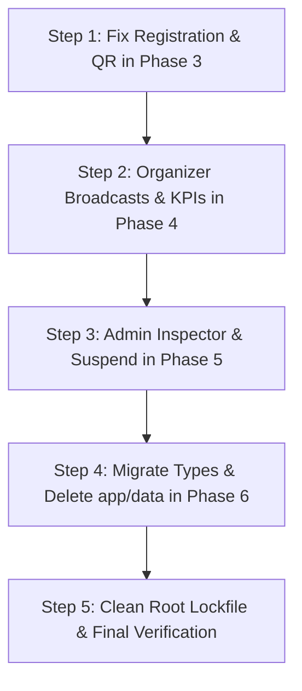

# Eventify Migration: Remaining Tasks & Action Plan

This document outlines the remaining tasks to complete 100% of the **Mock Data → Supabase Migration Guide**.

---

## Current Status Overview
- **Build Status**: Passing (`npx tsc --noEmit` and `npm run build` succeed with 0 errors).
- **Core Database Features**: Schema tables (19), SSR cookie auth, role-based middleware guards, public event listings, and basic registration RPC are working.
- **Pending Work**: Connecting real data to remaining UI widgets, removing hardcoded KPI metrics/counts, implementing missing server actions (broadcasts, event updates, suspensions, notes), dynamic QR generation, and deleting legacy mock files.

---

## Phase 2: Sign-Up College Selection

### Task 2.1: Load Colleges Dynamically
- **File**: `evntify/component/login/signup/signupform.tsx` (lines 15–20)
- **Problem**: Currently defines a hardcoded array `const COLLEGES = [...]`.
- **Action**:
  - Query the `colleges` table in `app/signup/page.tsx` via `createClient()`.
  - Pass the list as a prop to `<SignUpForm colleges={colleges} />`.
- **Done When**: Adding a college to the Supabase database automatically appears in the sign-up dropdown without code changes.

---

## Phase 3: Registration & Fast-Pass

### Task 3.1: Check Existing Registration on Page Load
- **Files**:
  - `evntify/app/events/[id]/page.tsx`
  - `evntify/app/events/[id]/event-details-client.tsx` (lines 51–53)
- **Problem**: `isRegistered` defaults to `false`. If an already registered student reopens the event page, they see the "Register" button again.
- **Action**:
  - In `app/events/[id]/page.tsx`, check `supabase.from('registrations').select('ticket_code, status').eq('event_id', event.id).eq('user_id', user.id).single()`.
  - Pass `initialRegistration={{ isRegistered: boolean, ticketCode: string, status: string }}` to `EventDetailsClient`.
  - If registered, show **"View Fast-Pass"** or the claimed ticket badge instead of the Register button.
- **Done When**: Refreshing the page as a registered student immediately shows your ticket code and Fast-Pass button.

### Task 3.2: Enforce Registration Deadline
- **File**: `evntify/app/events/[id]/event-details-client.tsx` (lines 58–87, 510–540)
- **Problem**:
  - Countdown timer initial state starts with placeholder `"02" / "14" / "22"`.
  - The "Register Now" button remains active even after the deadline passes.
- **Action**:
  - Calculate initial countdown state immediately using `event.registrationDeadline`.
  - If `new Date() > new Date(event.registrationDeadline)`, disable the registration button and display a badge: `"Registration Closed"`.
- **Done When**: Setting an event deadline in the past makes the Register button disabled with a clear "Registration Closed" label.

### Task 3.3: Replace Fake SVG with Dynamic QR Code
- **Files**:
  - `evntify/package.json`
  - `evntify/app/events/[id]/event-details-client.tsx` (lines 676–710)
  - `evntify/component/user-profile/EventCards.tsx` (Fast-Pass QR view)
- **Problem**: The modal renders a hardcoded static SVG drawing of a QR code that does not encode `ticket_code`.
- **Action**:
  1. Install `qrcode` and its types:
     ```bash
     cd evntify && npm i qrcode && npm i -D @types/qrcode
     ```
  2. Generate a data URL from `ticketCode` using `QRCode.toDataURL(ticketCode)` or use a lightweight SVG QR component.
  3. Render the generated image in the Fast-Pass modal.
- **Done When**: Scanning the QR code with a phone camera reads the student's exact `ticket_code` (e.g. `TYK11-XXXXXXXX`).

---

## Phase 4: Organizer Dashboard

### Task 4.1: Dynamic Event Registry Filter Counts
- **File**: `evntify/app/organizer-dashboard/organizer-dashboard-client.tsx` (lines 727–768)
- **Problem**: Filter pill buttons have hardcoded numbers: `All (3)`, `Active (1)`, `SAO Pending (1)`, and `Archived (2)`.
- **Action**:
  - Compute counts dynamically from `events`:
    ```ts
    const counts = useMemo(() => ({
      all: events.length,
      active: events.filter(e => e.status === "live" || e.status === "soldout").length,
      sao: events.filter(e => e.status === "pending").length,
      archived: events.filter(e => e.status === "archived").length,
    }), [events]);
    ```
  - Display `{counts.all}`, `{counts.active}`, `{counts.sao}`, `{counts.archived}` in the buttons.
- **Done When**: Filter pill counts match the actual number of events in each tab.

### Task 4.2: Replace Hardcoded Organizer KPI Cards
- **Files**:
  - `evntify/lib/db/stats.ts` or `evntify/lib/db/organizer.ts`
  - `evntify/app/organizer-dashboard/organizer-dashboard-client.tsx` (lines 611–689)
- **Problem**:
  - Card 2 hardcodes: `03 venues booked`, `6 operating now`.
  - Card 3 hardcodes: `01 in dean review`, `Est. Turnaround ~4.2 hrs`.
  - Card 4 hardcodes: Reach count and progress.
- **Action**:
  - Return KPI counts from `getOrgEvents()` or `lib/db/stats.ts`:
    - Live operating events count.
    - Pending approval count (`approval = 'pending'`).
    - Distinct venues booked.
  - Pass these metrics into `OrganizerDashboardClient`.
- **Done When**: Submitting a new event increments the pending count on the KPI card.

### Task 4.3: Implement `updateEvent()` Server Action
- **File**: `evntify/app/actions/events.ts`
- **Action**:
  - Add `updateEvent(eventId: string, data: UpdateEventInput)`:
    - Validate with Zod.
    - Verify user belongs to the event's organization or is an admin.
    - Update the `events` table row.
    - `revalidatePath('/organizer-dashboard')` and `revalidatePath('/events')`.
- **Done When**: Editing event details from the organizer dashboard saves changes to the database.

### Task 4.4: Wire Broadcasts Action & Delivery Logs
- **Files**:
  - Create `evntify/app/actions/broadcasts.ts`
  - `evntify/app/organizer-dashboard/organizer-dashboard-client.tsx` (lines 251–262, 1590–1650)
- **Problem**:
  - Clicking "Broadcast Now" only displays a toast message: `🚀 Broadcast sent to 2,940 students...`.
  - Broadcast delivery logs modal displays static dummy rows.
- **Action**:
  1. In `app/actions/broadcasts.ts`, create `sendBroadcast({ eventId, message, channels })`:
     - Validate `message.length <= 240`.
     - Insert a row into the `broadcasts` table (`sender_id`, `event_id`, `message`, `channels`).
     - Query attendees registered for the event and insert rows into `notifications` and `broadcast_deliveries`.
  2. Wire the composer form in `organizer-dashboard-client.tsx` to `sendBroadcast`.
  3. Load actual delivery logs from `broadcasts` and `broadcast_deliveries` inside the modal.
- **Done When**: Broadcasting a message creates real notification rows in the database for registered attendees.

---

## Phase 5: Admin Portal

### Task 5.1: Real Clearance Rate & Review Time Calculation
- **File**: `evntify/component/admin/ApApprovalsView.tsx` (lines 23–25, 200–240)
- **Problem**: Clearance rate is hardcoded as `const RATE = 92;` and review turnaround time is hardcoded as `~4.2 hrs`.
- **Action**:
  - In `lib/db/stats.ts`, compute:
    - Clearance rate: `(approved / (approved + rejected)) * 100`.
    - Average turnaround: average diff between `decided_at` and `submitted_at`.
  - Pass these values into `ApApprovalsView`.
- **Done When**: Approving or rejecting a proposal adjusts the live clearance percentage.

### Task 5.2: Inspector Drawer (Facilities, Notes, Suspension)
- **Files**:
  - `evntify/component/admin/EdInspector.tsx`
  - `evntify/component/admin/EdEventsView.tsx`
  - `evntify/app/actions/events.ts` (or `app/actions/admin.ts`)
- **Problem**:
  - Facilities display dummy placeholder values `["—", "—", "—", "—"]`.
  - Supervisory notes are stored only in React state and never persisted to `admin_notes`.
  - The "Suspend" button has no action attached.
- **Action**:
  1. Query `event_facilities` for the selected event and show active facilities.
  2. Add `saveAdminNote(eventId: string, note: string)` Server Action that inserts into `admin_notes`.
  3. Add `suspendEvent(eventId: string, reason: string)` Server Action:
     - Sets `events.status = 'suspended'`.
     - Inserts an entry into `audit_logs` (`action = 'event_suspended'`).
     - Revalidates `/admin/events-directory` and `/events`.
- **Done When**: Clicking Suspend changes the event status in the database and reflects immediately on the UI.

---

## Phase 6: Final Cleanup & Hardcoded String Removal

### Task 6.1: Delete Legacy Mock Files in `app/data/`
- **Files to remove**:
  - `evntify/app/data/proposals.ts`
  - `evntify/app/data/events-directory.ts`
  - `evntify/app/data/events.ts`
- **Dependencies to migrate first**:
  - Move UI type definitions (`Proposal`, `EventItem`, `Decision`, `EventCard`) to `evntify/types/` or `evntify/lib/db/stats.ts`.
  - Move `pct()` helper from `events-directory.ts` into a utility file (e.g. `lib/utils.ts` or `lib/events.ts`).
  - Update `marqueeRows` in `component/landingpage/showcase.tsx` to read from upcoming campus events or a dedicated landing content config.
  - Delete `app/data/`.
- **Done When**: The `app/data` folder is completely removed and `npm run build` succeeds.

### Task 6.2: Remove Hardcoded Fallback Texts
- **File**: `evntify/app/events/[id]/event-details-client.tsx` (lines 323–331)
- **Problem**: Still contains hardcoded fallback description:
  `"The LITS Arena: Figma Showdown 2026 gathers aspiring campus product designers..."`.
- **Action**: Replace with a clean generic empty state or prompt (e.g. `"No event description provided by organizer."`).

### Task 6.3: Remove Redundant Root `package-lock.json`
- **File**: `c:\Users\Vonn\CIM1101---Project\package-lock.json`
- **Problem**: An empty lockfile in the parent directory causes Next.js Turbopack to show a workspace root inference warning on every build.
- **Action**:
  ```bash
  rm package-lock.json
  ```
- **Done When**: Running `npm run build` inside `evntify` outputs no workspace root warning.

---

## Recommended Execution Order



1. **Step 1 (User-Facing / High Impact)**:
   - Install `qrcode`.
   - Update `event-details-client.tsx` to show dynamic QR code and registered state on load.
   - Enforce registration deadline on the Register button.
2. **Step 2 (Organizer Management)**:
   - Dynamic registry counts and KPIs on the Organizer Dashboard.
   - Implement `sendBroadcast` server action.
3. **Step 3 (Admin Capabilities)**:
   - Implement `suspendEvent` and `saveAdminNote` in `EdInspector`.
4. **Step 4 (Code Quality & Cleanup)**:
   - Move types out of `app/data/*` and delete `app/data/`.
   - Delete root `package-lock.json`.
5. **Step 5 (Final Gate)**:
   - Run `npx tsc --noEmit && npm run build` to confirm clean production readiness.

